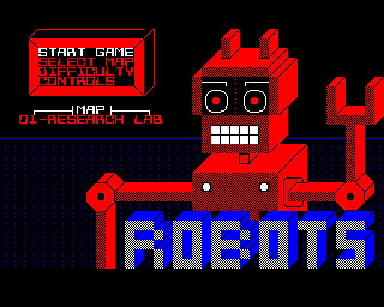
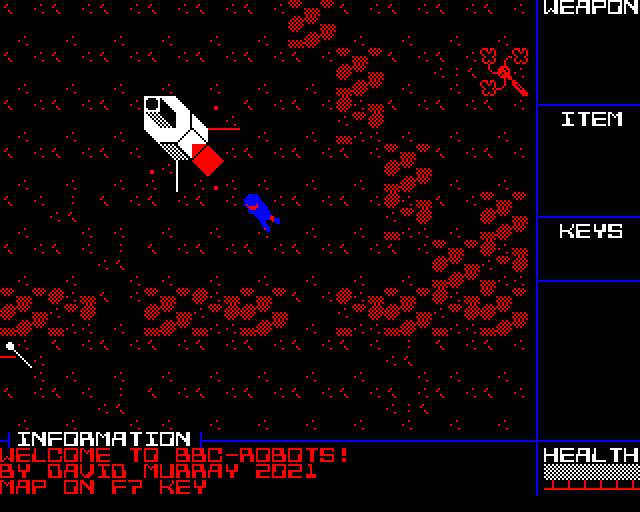

# Attack of the PETSCII Robots - BBC Master

A port of David Murray's *Attack of the PETSCII Robots* to the BBC Master 128, in shadow Mode 1 (320x256, 4 colours).
It is built from his C64 source and game-logic files (see `upstream/` and the copyright headers in `source/`, which stay
as they are). Technical notes: `PORTING.md`.

**Status: playable proof of concept.** All 14 levels are on the disc and the game plays from the intro menu to level play
(seen in b-em as a Master 128; not yet on real hardware). No sound or music, no overview map yet - see the to-do list in
`PORTING.md`.

Email contact@radrestoration.com for bug reports.  This port was made with the help of Claude Code. 

David Murray is aware of this port, and has distributed PETSCII Robots under the terms of the GPLv3. 

  
  

## Building and running
Needs cc65 (`ca65`, `ld65`), python3 with numpy and Pillow, and git (to fetch the original sources).
    make ssd            # fetches the C64/PET sources it reads into upstream/ (tools/fetch_upstream.sh), converts the
                        # assets, assembles and writes build/robots.ssd
    ./run-bbc.sh        # b-em, Master 128, autoboot
Tool locations (cc65, b-em) can be set in `tools.cfg` (copy `tools.cfg.tmpl`); by default they are taken from your PATH.
`make test` runs the simulator tests (about 3 minutes).
On a real Master: put `robots.ssd` on a disc, hold Shift and tap Break. It needs sideways RAM banks 4 and 5 (both are
RAM on a stock Master 128).

## Keys
| Key | Action |
|---|---|
| I / K / J / L, or cursor keys | move up / down / left / right |
| W / S / A / D | fire up / down / left / right |
| f1 / f3 | cycle weapons / items |
| Space | use item |
| Z | search object |
| M | move object |
| Escape | pause (then Y quits the level, N or Escape resumes) |
| Return, cursor up/down | intro menu |
| f7 | overview map (not implemented yet) |
| Shift+M | music (not implemented yet) |
| Tab | cheat (the C64's C= + *) |

The key table is `KEYSET` in `source/platform/bbc/hal_main.s`.

## Layout
    source/            robots.s (the game), background_tasks.s (game logic), bbc.cfg (linker), loader.cfg
    source/platform/bbc/   defs.s (memory map), hal_low.s, hal_gfx.s, hal_main.s (renderer, sprites, keyboard, vsync), loader.s
    tools/             asset conversion, disc builder, simulator and tests
    upstream/          third-party sources fetched by tools/fetch_upstream.sh (not in this repo)
    docs/              screenshot from b-em
    build/             generated
`make help` lists the targets; `make test` runs the headless simulator tests.
